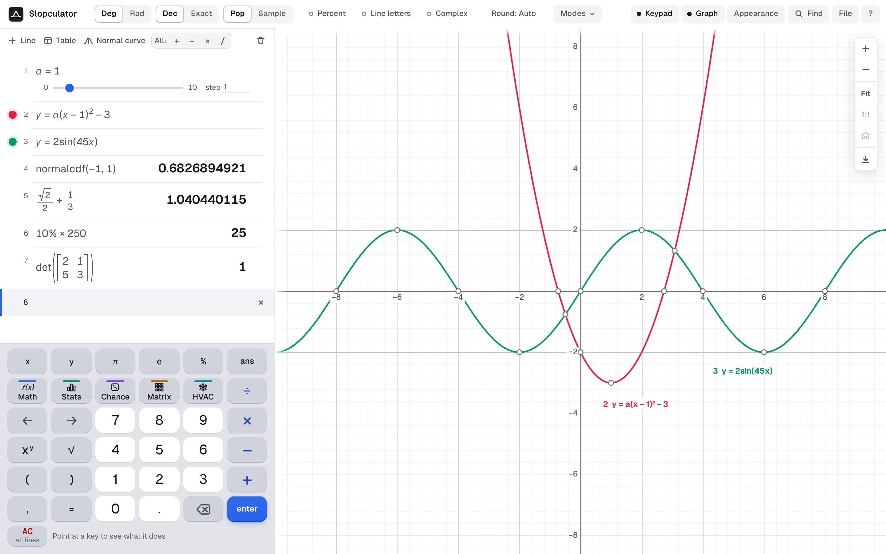

# Slopculator

[](https://github.com/Ferro-5G/slopculator/actions/workflows/ci.yml)
[](LICENSE)

A free, open-source graphing calculator on a live canvas. Use it at **[slopculator.com](https://slopculator.com)** or download a single offline HTML file from [Releases](https://github.com/Ferro-5G/slopculator/releases/latest).



## What it does

- **Connected lines.** `a = 3` makes a slider, `f(x) = x^2` graphs and can be called later, and linked blocks update as you drag.
- **Exact math.** `0.1 + 0.2` is `3/10`, `2^64` keeps every digit, and roots, logs, and trig only show proven digits.
- **296 functions.** Statistics, distributions, regressions, matrices, vectors, calculus, units, and HVAC tools. See [docs/functions.md](docs/functions.md).
- **Offline and private.** No accounts, analytics, or network requests. Sheets stay in your browser. See [PRIVACY.md](PRIVACY.md).

## Run locally

Requires Node 22+:

```sh
npm install
npm run dev      # http://localhost:5173
npm test
npm run build    # dist/index.html (single offline file)
```

To build the hosted website (landing page, `/app`, `/privacy`, and headers), run `SITE_URL=https://calc.example.com/ npm run build`. See [docs/hosting.md](docs/hosting.md).

## Platforms

Web runs in any browser via [slopculator.com](https://slopculator.com) or `dist/index.html`. iOS and Android apps are in development and aren't in this repository yet.

## Docs

- [Using the app](docs/using.md)
- [Worked examples](docs/guide.md)
- [Function reference](docs/functions.md)
- [Page API](docs/page-api.md)
- [Architecture](docs/architecture.md)
- [Hosting](docs/hosting.md) and [Releasing](docs/releasing.md)
- [Changelog](CHANGELOG.md) and [Roadmap](docs/roadmap.md)

## Contributing and license

Bug reports and PRs are welcome; see [CONTRIBUTING.md](CONTRIBUTING.md). Licensed under [MIT](LICENSE) (third-party licenses in [THIRD_PARTY_NOTICES.md](THIRD_PARTY_NOTICES.md)).
