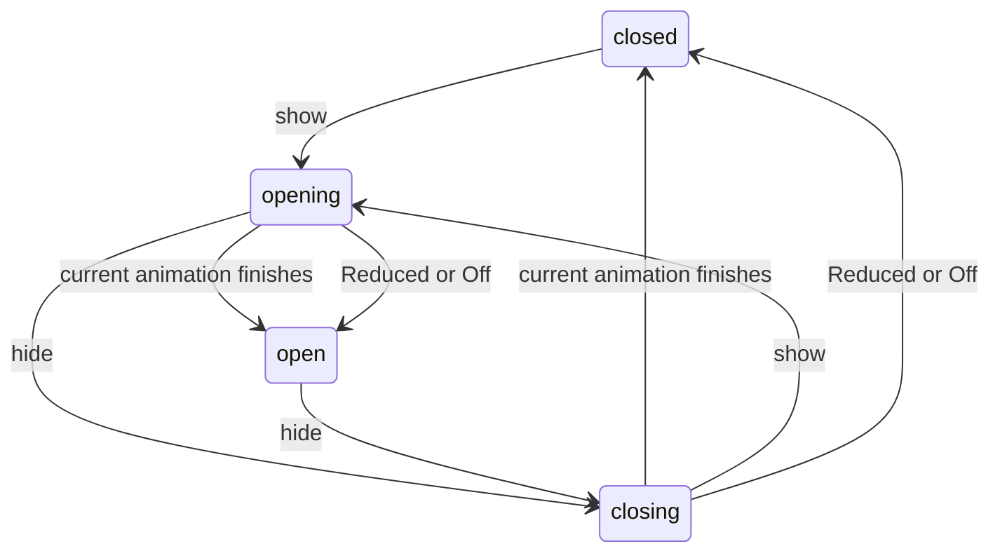

# Frontend motion states

The web and Windows app use independent machines for presence, notebook scrolling and graph navigation. A single global state would incorrectly couple actions such as opening a sheet and moving a graph. Saved preferences describe what should be visible; animation progress is temporary.

## Presence

`src/ui/presence.ts` defines the DOM-free machine. `src/app/motion.ts` drives the Modes sheet and its scrim. The desktop keypad and graph-pane entry use the same generation-tagged presence states with their existing Web Animations.

- A new request increments the generation. A completion from an older generation cannot change state.
- Repeated identical intent does not restart a transition.
- `closed` means hidden, with no `open` class. `closing` remains present until the exit finishes.
- The Modes sheet keeps the background inert and its focus boundary active through closing. It releases them only when closed.
- Opening owns its pending animation frame. A close cancels that frame; even a late delivery is rejected by generation.
- Reversals retarget the browser's current rendered position. The Modes sheet and scrim share a non-bouncy 180 ms drawer timing.

The DOM exposes each surface's phase as `data-presence` for inspection. Completion follows the actual CSS/WAAPI animation, without a guessed closing timeout.

## Motion policy

`motionOf` resolves Full, Reduced and Off against the system preference. When positional motion is disabled, registered presence transitions settle to their current requested endpoint. Graph zoom settles to its requested view; an active graph coast stops where it is. Notebook alignment settles to its chosen line boundary. Direct pointer tracking remains available.

This repairs confirmed wrong states:

| Before | Correct transition |
| --- | --- |
| Modes had `aria-expanded=false` but a queued frame restored its open appearance | Hide invalidates the entry generation; the stale frame does nothing |
| An exiting sheet was visible while the page behind it was interactive | Closing retains modal input ownership until hidden |
| Graph zoom, panel folding or notebook alignment continued after Off | The policy change ends the owned motion immediately |
| A cancelled panel animation could clean up a newer transition | Only the current generation can finish or clean up |
| A zoom kept moving under a held pointer until it moved | Pointer-down immediately cancels glide/coast and owns the current view |

The notebook's existing `rest / touch / drag / user / code / settling` machine remains in `src/app/listscroll.ts`. Graph input, glide and coast remain owned by `Graph`; this change makes policy updates cancel its active frames. Mobile's native sheets and navigation remain platform-owned; the pure presence machine adds no browser dependency to shared code.

## Verification

`test/presence.test.ts` checks stale completion, reversal, immediate settling, duplicate intent and immutable snapshots. Browser checks named `motion states:` exercise the built app under interrupted entry, modal close/reopen, active zoom policy changes, panel cancellation, notebook alignment and pointer takeover during a zoom. Use `E2E_MATCH='motion states:' node scripts/e2e.mjs` after `npm run build`.

The Windows process lifecycle is separate. These frontend transitions do not implement native application exit and do not claim to repair Agent Desktop's windowless-process close limitation.
