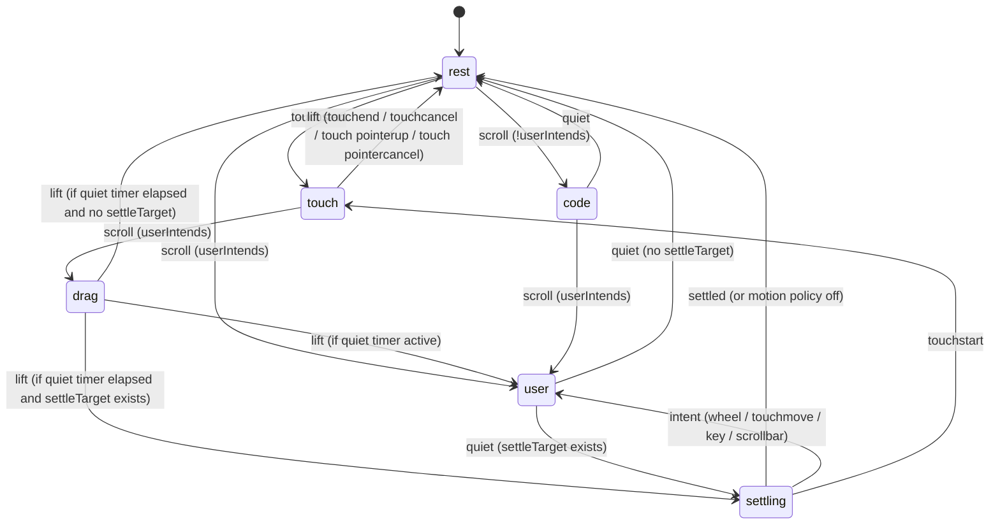
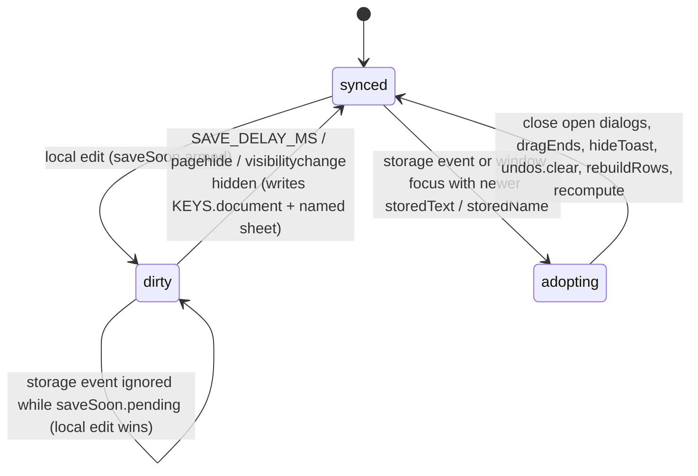
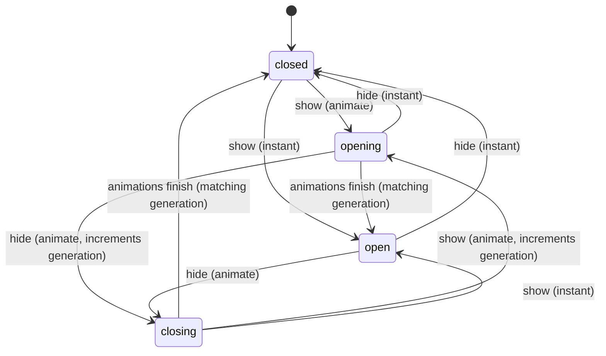

# Statecharts

Interactive state machines in Slopculator, their writers, and the bad paths they guard against.

## 1. Notebook scroll and edge covers

Lives in [src/app/listscroll.ts](../src/app/listscroll.ts). Exposed on the list container as `data-scroll`.

Writers and side variables:
- `listState`: mutated only inside `listEvent`.
- `intentUntil`: set to `now + 250` on wheel, touchmove, or navigation keys; set to `Infinity` on scrollbar `pointerdown` and released on `window` `pointerup` or `pointercancel`; reset to `0` on `quiet` when finite.
- `settleTimer`: `QUIET_MS` (`600` ms when `scrollend` exists, `160` ms otherwise) fallback in case `scrollend` does not fire.
- `settleFrame` and `settleDestination`: owned by `settleTop`, cleared by `endSettle`, and jumped to completion by `registerMotionSettler` when motion changes to Reduced or Off.

Guarded bad paths:
- A cancelled scrollbar or touch drag on `pointercancel` must release `intentUntil` and `touch`, otherwise `intentUntil` stays `Infinity` and programmatic scrolls falsely trigger settling.
- Edge covers (`coverTop`, `coverBottom`) only paint in `rest` so bands never pop in mid-fling.
- `revealRow` scrolls without user intent, landing in `code`, which returns to `rest` without snapping away from the revealed line.

## 2. Slider range lock during drag

Lives in [src/ui/slider.ts](../src/ui/slider.ts), [src/app/lineoutput.ts](../src/app/lineoutput.ts), and [src/app/graphpane.ts](../src/app/graphpane.ts).

```mermaid
stateDiagram-v2
  [*] --> idle
  idle --> dragging: focus / pointerdown on range input
  dragging --> dragging: input (value rewrites line; min, max, step stay locked)
  dragging --> idle: change / blur (endDragOnRelease finishes undo drag, next render refits wholeAwareRange)
```

Writers:
- `wholeAwareRange(value, row.slider)` computes automatic bounds from the current number.
- `syncSlider` ([src/app/lineoutput.ts](../src/app/lineoutput.ts)) and `syncGraphSliders` ([src/app/graphpane.ts](../src/app/graphpane.ts)) both skip `fitRange` while `document.activeElement === range`, updating only `--p` track fill and value readout until release.
- `endDragOnRelease` batches drag edits into one `UndoStack` entry via `valueDrag` ([src/ui/undo.ts](../src/ui/undo.ts)).

Guarded bad paths:
- Updating `range.min` or `range.max` during an active drag makes the thumb jump under the pointer whenever the value crosses a `niceCeil` threshold (for example dragging `a = 1` past `5`).

## 3. Two-tab storage sync, debounced saves, and undo

Lives in [src/app/sheet.ts](../src/app/sheet.ts), [src/app/file.ts](../src/app/file.ts), [src/app/edits.ts](../src/app/edits.ts), and [src/ui/undo.ts](../src/ui/undo.ts).

Writers:
- `saveSoon` debounces writes to `localStorage` and flushes immediately on `pagehide` and `visibilitychange` (hidden) so mobile browsers cannot drop the last edit on backgrounding.
- `followOtherTab` runs on `storage` and `focus`, taking the newer sheet only when `saveSoon.pending()` is false.
- `UndoStack` (`UNDO_DEPTH = 50`) coalesces typing bursts within 1,000 ms on the same row and clears completely when another tab replaces the sheet.

Guarded bad paths:
- An open `<dialog>` (Rename, History, Save) references the pre-sync sheet; `followOtherTab` closes every `dialog[open]` with `'cancel'` before replacing `doc`.
- `applyingUndo` guards `recordTyping` so programmatic undo/redo writes never push recursive typing steps.

## 4. Presence and motion policy

Lives in [src/ui/presence.ts](../src/ui/presence.ts) and [src/app/motion.ts](../src/app/motion.ts). Exposed as `data-presence` on managed surfaces.

Guarded bad paths:
- Every transition increments `generation`. Stale `requestAnimationFrame` callbacks and resolved Web Animation promises from older generations are ignored.
- Modal sheets keep background `inert` until `phase === 'closed'`, never releasing background interaction mid-close.
- Changing motion policy to Reduced or Off calls `settleMotions()`, which settles active presence transitions, scroll glides, and graph coasts immediately.
